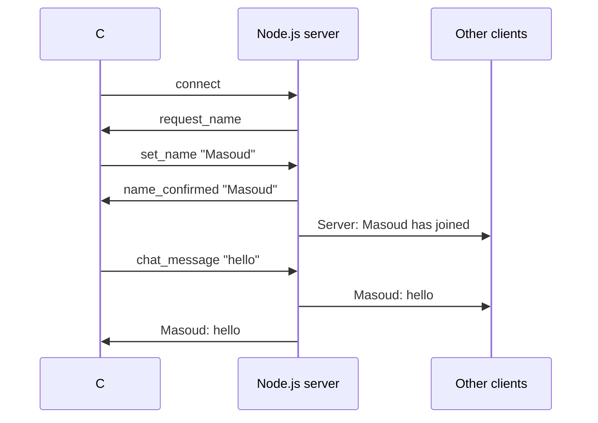

# 💬 Project Chat


[](https://github.com/CodTanium/Project-Chat/actions/workflows/ci.yml)

A **real-time multi-user chat**: a Node.js server with Socket.IO, and a **C# console client**. Several people connect, pick a name and chat; every message reaches everyone instantly, each user in their own colour.

```
✅ Connected to http://localhost:3000
Enter your name: Masoud
You are "Masoud". Type a message and press Enter. /users = who is online, exit = quit.
Server: Masoud has joined the chat! (2 online)
Anna: hi Masoud!
Masoud: hello from the C# client
Server: Online: Anna, Masoud
```

## Features

- ⚡ Real-time messages over WebSockets (Socket.IO)
- 🎨 Every user gets their own colour in the console
- 🪪 Names are trimmed and made unique (`Sam`, `Sam2`); nobody can pose as "Server"
- 👥 `/users` shows who is online (only to you)
- 🛡️ Empty, wrong-type and over-long messages (over 500 characters) are handled safely
- 📣 Join and leave messages, and a `/health` endpoint for the server

## Tech stack

| Part | Technology |
|---|---|
| Server | Node.js, Express 5, Socket.IO 4 |
| Client | C# / .NET 9 console app, SocketIOClient |
| Tests | Node's built-in test runner + socket.io-client, GitHub Actions |

## Run it

**1. Start the server** (http://localhost:3000):

```bash
npm install
npm start
```

**2. Start one or more clients** (each in its own terminal):

```bash
dotnet run --project chat-client
# or connect to another server:
dotnet run --project chat-client -- http://192.168.1.20:3000
```

Type a message and press Enter. `/users` lists who is online, `exit` quits.

### Settings

| Variable | Used by | Default | Meaning |
|---|---|---|---|
| `PORT` | server | `3000` | Port to listen on |
| `CORS_ORIGIN` | server | `*` | Allowed browser origins |
| `CHAT_SERVER_URL` | client | `http://localhost:3000` | Server to connect to (a command-line argument wins) |

## Tests

```bash
npm test
```

Six tests start a real server and real Socket.IO clients: messages reach everyone, names are unique, bad input is ignored, `/users` only goes to the asker, and leaving is announced.

## How it works



## Project structure

```
Project-Chat/
├── server.js               Socket.IO chat server
├── test/chat.test.js       server tests
├── chat-client/
│   ├── Program.cs          C# console client
│   └── ChatClient.csproj
└── ProjectChat.sln
```

## What I learned

- Event-based, real-time communication with WebSockets
- Connecting two languages (JavaScript and C#) through one protocol
- Validating input on the server instead of trusting clients
- Testing a network server with real clients

---

Made by [Masoud Dehdar](https://github.com/CodTanium).
